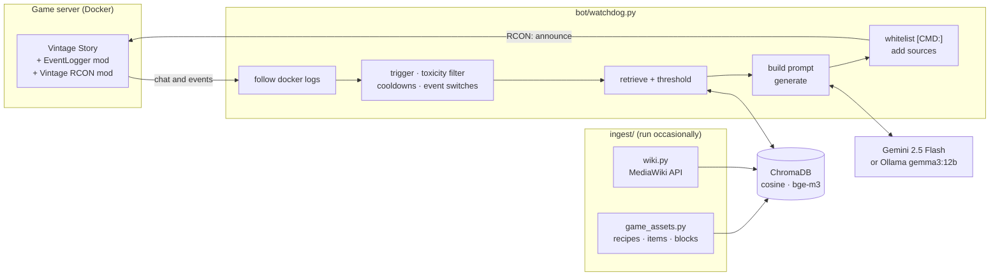

# vs-story-ai

**An in-game AI assistant for a Vintage Story server — answers players' questions in chat, grounded in the game's own data.**

[](https://github.com/Darkobus/vs-story-ai-implementation/actions/workflows/ci.yml)


Players on a multiplayer [Vintage Story](https://www.vintagestory.at/) server ask a question in chat,
and the bot answers a few seconds later — with exact recipes and ratios taken from the game files and
the official wiki, not from a language model's memory. It also greets players, warns about temporal
storms, and drops an occasional gameplay tip.

```text
Ola: AI jak zrobić brąz cynowy?
AI:  Brąz cynowy to 8–12% cyny i 88–92% miedzi, stopione razem w tyglu. Potem odlej go do formy.
     (źródła: dane gry „tinbronze”, wiki „Tin bronze”)
```
<sub>Example exchange. Players write Polish, so the bot answers in Polish — <em>“How do I make tin bronze?” →
“Tin bronze is 8–12% tin and 88–92% copper, melted together in a crucible. Then cast it in a mould.”</em></sub>

It runs 24/7 on a small home server as a systemd service, next to the game's Docker container.

---

## Highlights

- **Grounded answers, not guesses.** Retrieval-augmented generation over the game's recipes, items
  and blocks plus the wiki. A relevance threshold drops weak matches; when nothing matches, the
  bot says it doesn't know instead of inventing a Minecraft recipe.
- **Asks in Polish, searches in English.** A multilingual embedding model (`bge-m3`) puts both
  languages in one vector space, so no translation step sits between the question and the search.
- **Shows its sources.** Every grounded answer ends with where it came from — a wiki page or a game file.
- **Discoverable.** `AI pomoc` explains how to use it, and every join greeting points to that.
- **Quiet by default.** Event reactions and tips are switchable per type; deaths and kills are off.
- **Safe with the server.** The model can request only two commands (`time`, `weather`), and only as an
  exact match from a whitelist — nothing it writes can become `op` or `give`.
- **Cheap to run.** Embeddings run on the server's CPU; generation goes to Gemini 2.5 Flash, or to a
  local Ollama model if you'd rather keep everything at home.

## How it works



1. **Ingest (once in a while).** Game JSON5 files are parsed, stripped of rendering data and turned into
   short sentences (`Alloy recipe: tinbronze — ingot-tin 8-12%, ingot-copper 88-92%`). Wiki pages are
   fetched through the MediaWiki API and cleaned of markup, keeping infobox data and tables. Everything
   is chunked, embedded and stored with its source.
2. **Runtime (always).** The bot follows `docker logs -f` of the game container. A chat line starting
   with `AI` becomes a question: it is embedded, the nearest chunks within the distance threshold are put
   into the prompt with the player's last few exchanges, and the answer goes back to chat over RCON.
   Questions run in a thread pool, so a slow model never blocks the log loop.

## Design notes

A few decisions that shaped the project — the [docs](docs/index.html) go deeper.

| Problem | Decision |
|---|---|
| A vector search *always* returns its nearest neighbours, even for unrelated questions — and the model then answers confidently from junk. | A cosine-distance threshold (`RAG_MAX_DISTANCE`). No relevant chunk → the prompt tells the model to admit it doesn't know. |
| Polish questions, English knowledge. The first version translated every question with an extra LLM call, which was slow and sometimes turned *brąz* (bronze) into “brown”. | A multilingual embedding model instead of translation. |
| Vectors from different embedding models (or metrics) are incomparable, and mixing them fails silently. | The collection records the model that built it; opening it with another model, or an L2 collection, is refused. Embedding failures raise — never zero vectors. |
| The common RCON library times out with `signal.alarm`, which only works in the main thread. | A small socket-based RCON client with a lock, safe to call from worker threads. |
| Asking the model for “a tip” gave either ungrounded trivia or nothing that passed the threshold. | Tips start from a random knowledge-base chunk; the model rewrites it or answers `SKIP`. |
| A dark “god” persona was fun for five minutes and got in the way after that. | A plain, friendly assistant: answer first, at most four sentences, exact numbers from the data. |
| Fine-tuning a 7B model on the bot's style ([archived](archive/)) taught tone, not facts, and went stale with every game update. | RAG plus a good prompt. |

## Quick start

**Requirements**
- A Vintage Story server in Docker with the [Vintage RCON](https://mods.vintagestory.at/vintagercon) mod
  (the game's built-in remote console isn't Source-RCON compatible). Default port: 42421.
- [Ollama](https://ollama.com/) with `bge-m3` for embeddings (CPU is enough).
- A [Gemini API key](https://aistudio.google.com/apikey), or an Ollama generation model.
- Python 3.10+. Optional: the `EventLogger` mod from `mods/` for death and kill events.

```bash
git clone https://github.com/Darkobus/vs-story-ai-implementation.git
cd vs-story-ai-implementation
python -m venv venv && source venv/bin/activate
pip install -r requirements.txt
cp .env.example .env            # set VS_RCON_PASSWORD, and GEMINI_API_KEY if you use Gemini
ollama pull bge-m3

# build the knowledge base (the first command creates a fresh collection)
python -m ingest.game_assets --reset
python -m ingest.wiki --all

python -m tools.healthcheck     # embeddings, knowledge base and RCON reachable?
python -m bot.watchdog
```

All commands run from the repository root. To run it as a service, see
[`deploy/vsbot.service`](deploy/vsbot.service) (systemd; reads secrets from `.env`).

<details>
<summary><b>Building the knowledge base on another machine</b></summary>

Embedding tens of thousands of chunks with `bge-m3` takes hours on a CPU. You can build on a PC with a
GPU and copy the result — use the same `chromadb` version on both (it is pinned in `requirements.txt`).

```bash
# on the server: export the game's assets so they match its game version
docker cp vs-ai-server:/game/assets/survival ./vs-assets/survival

# on the PC (Ollama with bge-m3 running locally)
python -m ingest.game_assets --reset --assets-dir ./vs-assets
python -m ingest.wiki --all            # add --en for English pages only
# then copy chroma_db/ to the server's repository root
```
</details>

<details>
<summary><b>Calibrating the relevance threshold</b></summary>

`RAG_MAX_DISTANCE` (cosine distance, default `0.5`) decides which chunks count as relevant. Run a mix
of questions the bot should answer and off-topic ones:

```bash
python -m tools.dbcheck "jak zrobić brąz cynowy" "gdzie znaleźć miedź" "przepis na pizzę"
```

and set the threshold between the two groups. Too many “I don't know” answers → raise it;
off-topic chunks still getting through → lower it. The bot also logs every query's distances.
</details>

## In game

| Player writes | Bot does |
|---|---|
| `AI <question>` — also `ai:`, `ai,`, `@ai` | answers from the knowledge base, with sources |
| `AI pomoc`, `AI help`, `AI ?` | prints a fixed how-to-use message (no model call) |
| *joins the server* | short greeting + a hint about `AI pomoc` |
| *temporal storm approaches / passes* | a short warning / all-clear |
| — | a gameplay tip every 30–60 minutes |

## Configuration

Everything is set in `.env`; [`.env.example`](.env.example) lists every option with comments.

| Variable | Default | What it does |
|---|---|---|
| `VS_RCON_PASSWORD` | — (required) | RCON password of the game server |
| `VS_RCON_HOST` / `VS_RCON_PORT` | `127.0.0.1` / `42421` | where RCON listens |
| `VS_CONTAINER` | `vs-ai-server` | game container: log source and asset source for ingest |
| `GEMINI_API_KEY` | empty | set → generate with Gemini; empty → local Ollama |
| `OLLAMA_PC_HOST` / `OLLAMA_FALLBACK` | `192.168.0.24` / `0` | Ollama host for generation; `1` = fall back to it when Gemini fails |
| `OLLAMA_EMBED_HOST` / `OLLAMA_EMBED_MODEL` | `127.0.0.1` / `bge-m3` | embeddings; changing the model means rebuilding the knowledge base |
| `VS_COLLECTION` / `VS_CHROMA_PATH` | `vintage_story_kb` / `./chroma_db` | knowledge base location |
| `RAG_MAX_DISTANCE` | `0.5` | relevance threshold (`off` disables it) |
| `CHAT_COOLDOWN_SEC` | `10` | minimum gap between one player's questions |
| `EVENT_REACTIONS` | `join,leave,storm` | events to comment on: `join`, `leave`, `death`, `kill`, `storm`, `all`, `none` |
| `TIPS_ENABLED` / `TIPS_MIN_MINUTES` / `TIPS_MAX_MINUTES` | `1` / `30` / `60` | periodic tips |
| `CITE_SOURCES` / `JOIN_HINT` | `1` / `1` | sources after answers; how-to-ask hint on join |

## Tools

| Command | Purpose |
|---|---|
| `python -m tools.healthcheck` | pre-flight check: embeddings, knowledge base, RCON (exit code 0/1) |
| `python -m tools.dbcheck [questions…]` | query the knowledge base, print distances and sources |
| `python -m tools.console` | interactive RCON console |
| `python -m ingest.game_assets --dry-run` | parse the game files and print samples, write nothing |

## Project layout

```text
bot/watchdog.py      the bot: log loop, trigger, RAG, prompts, generation, events, tips
vsai/                shared code: config (.env), embeddings, knowledge base, RCON client
ingest/              game_assets.py (game JSON5 files), wiki.py (MediaWiki API)
tools/               healthcheck, dbcheck, console
mods/eventlogger/    C# server mod that logs deaths and kills for the bot
tests/unit/          pytest — including a real temporary ChromaDB with a fake embedder
deploy/              systemd unit
config/              example serverconfig.json (RCON block, placeholder password)
docs/                HTML write-up: architecture, RAG, ingest, bot, LLM, persona, roadmap
archive/             retired fine-tuning experiment, kept for reference
```

## Development

```bash
pip install -r requirements-dev.txt
pytest            # unit tests
ruff check .      # lint
mypy bot ingest tools vsai
```

CI runs all three on every push and pull request.

Repository text — code, comments, logs, docs, commits — is English. Only what the bot says in game is
Polish: the prompts are English and tell the model to reply in Polish.

## Documentation

[`docs/`](docs/index.html) is a seven-part illustrated write-up — open `docs/index.html` in a browser:

1. **Architecture** — the parts, and the 12-line loop the bot boils down to
2. **RAG** — embeddings, vector space, and cosine distance worked out by hand
3. **Ingest** — from JSON5 game files and wikitext to clean chunks
4. **The bot** — log following, the trigger, RCON, the command whitelist, threads
5. **LLM** — Gemini vs Ollama, prompt anatomy, temperature, why translation is gone
6. **Persona** — why the assistant replaced the “god”
7. **Roadmap** — what is done and what is next

## Roadmap

Next up: hybrid search (vectors + keywords) with reranking for exact item names, splitting
`watchdog.py` into modules, and mod assets in the knowledge base. Details in
[the roadmap](docs/07-roadmap.html).

## Acknowledgements

- [Vintage Story](https://www.vintagestory.at/) by Anego Studios, and the authors of the
  [Vintage Story wiki](https://wiki.vintagestory.at/).
- The [Vintage RCON](https://mods.vintagestory.at/vintagercon) mod by Shijikori.
- The knowledge base is built locally from your own game installation and the public wiki;
  no game data is stored in this repository.
